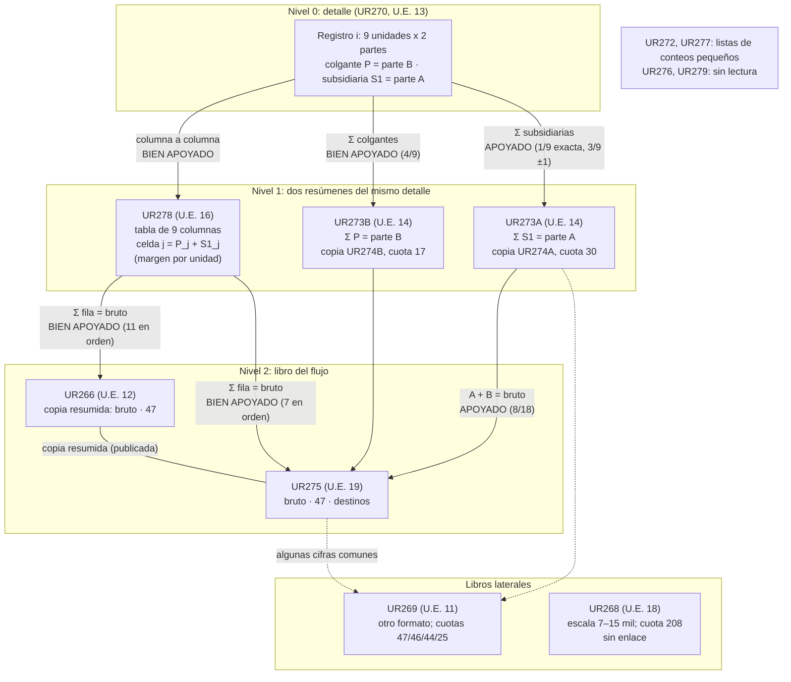

# El archivo del maní de Inkawasi: lectura integral

*Carpeta `analisis/29_lectura_incahuasi/`, 18-10-2026. Documento interno: no se ha enviado a nadie.*

Este documento reúne en una sola lectura todo lo que el proyecto sabe del montón de catorce quipus cubiertos de maní de Inkawasi (Incahuasi, valle de Cañete). Es una «traducción» razonada: dice qué es cada quipu, qué significa cada clase de cuerda y cómo se leería cada cifra. Cada afirmación lleva su nivel de evidencia y su fuente.

Acompañan a este texto:

- `tabla_traducida.csv`: 1 461 cifras de UR270, UR278, UR273A/B, UR274A/B, UR275, UR266, UR269 y UR268, cada una con su papel, su lectura, su enlace aritmético, su nivel y su fuente. La genera `construir_tabla.py`.
- `coherencia.py`: recalcula desde los datos 12 cifras clave y coteja los valores con OKR. La salida está en `salida_coherencia.txt` (12 de 12 correctas).

## 0. Cómo leer este documento

**Niveles de evidencia** (los de `paquete_revision/resumen_para_especialista.md` §2):

| Nivel | Qué significa |
|---|---|
| **Bien apoyado** | Sobrevive al nulo y a la corrección múltiple, y se replicó por otra vía: otro script, otro agente o una prueba ciega. |
| **Apoyado** | Es significativo con corrección, pero no tiene réplica independiente o depende de la regla elegida. |
| **Propuesto** | Es compatible con los datos, pero ninguna prueba lo distingue de las alternativas. |
| **Especulativo** | No tiene prueba. |
| **Retirado** | Se sostuvo en algún momento y las pruebas lo tumbaron. |

**Datos.** KFG (`analisis/datos/cuerdas.csv`) y OKR (`khipu.db`) dan los mismos valores en todos los colgantes de UR266, UR270, UR275 y UR278 (`coherencia.py`, comprobación 11), y en el 99,8 % de los valores de Inkawasi (`ds/n_cuota_entrega` §2.4). **Salvedad:** las dos bases son la misma lectura, hecha por la misma transcriptora. Nadie ha vuelto a leer los objetos de forma independiente.

**Nomenclatura.** `g21` es el grupo 21 de colgantes (numerado desde 0). `p180` es el colgante 180. **P** es un colgante y **S1** su primera subsidiaria. Un **registro** es un grupo de colgantes que no es separador rosado (PK).

**Versión de las afirmaciones.** Cuando hubo correcciones uso siempre la más reciente: SINTESIS «Ronda 14», `paquete_revision` y `ds/n_cuota_entrega`. Las afirmaciones retiradas están en el §7.

---

## 1. El archivo en una página

**Dónde.** Catorce quipus amontonados en la esquina suroeste de la kallanka U.A. 04 del depósito (Qolqawasi, sector A), cubiertos de maní. Son las unidades estratigráficas 11 a 22, consecutivas. *Bien apoyado como dato de campo* (Urton y Chu 2015, suplemento; Urton 2017, apéndice del cap. 9). El texto del capítulo 9 dice «U.A. 05» y el apéndice «U.A. 04»; la errata está anotada en SINTESIS §Urton 2017.

**Qué hay.** UR266, UR268, UR269, UR270, UR272, UR273A, UR273B, UR274A, UR274B, UR275, UR276, UR277, UR278 y UR279.

**Qué hacen.** Juntos son **una contabilidad encadenada de entregas de maní en tres niveles**:

1. **Detalle por unidad.** En cada registro de entrega, **9 unidades** fijas aportan cada una **dos partes**, A y B (UR270).
2. **Dos resúmenes cruzados del mismo detalle.**
   - Por unidad: UR278, una tabla de 9 columnas en la que cada celda es A+B de una unidad.
   - Por parte: UR273B suma las B de las 9 unidades y UR273A suma las A. Sus copias UR274B y UR274A llevan además una cuota fija.
3. **El libro.** UR275, y su copia resumida UR266, asienta para cada registro el total de bultos, una **cuota fija de 47** y el reparto del resto.

Los dos resúmenes llegan **a la misma cifra del libro por caminos distintos**. Es un cuadre cruzado: el total de las 9 unidades y el total de las 2 partes deben dar lo mismo.

**Niveles de cada pieza:**

- UR270 → UR278: **bien apoyado**.
- UR278 → UR275/UR266: **bien apoyado**.
- UR273A+B → UR275/UR266: **apoyado**.
- Leer el conjunto como cuadre cruzado: **propuesto**.



Versión en texto:

```
UR270  (9 unidades × {P=B, S1=A} por registro)
  ├── P_j + S1_j, columna a columna ─────────► UR278  (9 columnas; Σ fila)  ──┐
  ├── Σ_j P_j ─────────────► UR273B (=B) ≈ UR274B (+17)                      ├──► UR275 / UR266
  └── Σ_j S1_j ────────────► UR273A (=A) ≈ UR274A (+30) ── A + B ────────────┘   (bruto, 47, resto)
                                                                                 └─ algunas cifras en UR269
UR268 (cuota 208): sin enlace.   UR272, UR277, UR276, UR279: sin enlace.
```

---

## 2. Qué es cada quipu, en orden de flujo

| Orden | Quipu (U.E.) | Rol | Qué contiene | Nivel | Fuente |
|---|---|---|---|---|---|
| 1 | **UR270** (13) | **Detalle**: 9 unidades × 2 partes por registro | 25 grupos. Seis tienen 9 colgantes blancos (P), cada uno con una subsidiaria NB (S1): g0, g4, g5, g6, g8 y g9 (más g10 con 10). Los grupos g12–g24 tienen otro formato. | Bien apoyado (P+S1 → UR278; Σ P → UR273B) | `13` §2.3; `16` afirm. 4; `ds/n_cuota_entrega` §3.3 |
| 2a | **UR278** (16) | **Resumen por unidad**: tabla de 9 columnas | 37 grupos; 26 filas de exactamente 9. Valores de 11 a 537 por celda y totales de fila de 1 278 a 4 273. | Bien apoyado (celda = P+S1; Σ fila → libros) | `13` §2.3–2.4; `16`; `paquete_revision` I01, I02, I09, I10 |
| 2b | **UR273B** (14) | **Resumen por parte**: parte B de cada registro | Cabecera blanca en miles (887–3 991) y cuerdas en blanco. | Apoyado | `13` §2.2; `ds/n_cuota_entrega` §3.3C |
| 2b | **UR273A** (14), atado a UR273B | **Resumen por parte**: parte A | Cabecera en centenas (100–891). | Apoyado | `13` §2.2; `paquete_revision` I03 |
| 2c | **UR274B** (15) | Copia de UR273B con **cuota 17** explícita | 12 cuerdas de 17 y 4 de 10, que serían 17 dañadas. 1402 = 1385 + 17. | Apoyado (copia; cuota 17, p = 0,004 con OKR) | `13` §2.5; `ds/n_okr_incahuasi`; I19 |
| 2c | **UR274A** (15), atado a UR274B | Copia y **complemento** de UR273A con **cuota 30** explícita | 17 cuerdas de 30. Rellena 3 de 4 registros en los que UR273A está en blanco. | Apoyado (I04) | `13` §2.2; `ds/n_fuera_muestra` |
| 3 | **UR275** (19) | **Libro del flujo con reparto** | 25 registros: bruto, 47, destinos y un último destino grande jaspeado W:MB. Σ cabeceras = **56 446**, como en Urton y Chu 2018. | Bien apoyado (recibe UR278); apoyado (reparto 15/16) | `ds/n_tanteo` §4.1; `coherencia.py` 8 y 10 |
| 3 | **UR266** (12) | **Copia resumida del libro** | 36 grupos con bruto y 47. Empieza 4 registros antes que UR275 (3618, 1506, 1384, 2919). Tiene subsidiarias grandes 0G/0B (1070, 473, 1151…) sin regla. | Bien apoyado (copia publicada; recibe UR278 en orden) | `13` §2.9; Urton 2017 tabla 9.3 |
| — | **UR269** (11) | **Libro de otro formato** | 107 grupos en bloques separados por PK, con cuotas 47, 46, 44, 40 y 25. Contiene cuatro sumas A+B (1653, 1737, 1827, 1780) y la copia 2633. | Apoyado (recibe cifras); su estructura, propuesta | `13` §2.6, corregido por `18` y `ds/n_fuera_muestra` |
| — | **UR268** (18) | **Libro de escala mayor**, cuota 208 | Brutos de 7 135 a 15 039; 19 cuerdas de 208. No es la suma de los bloques de UR269. | Bien apoyado (cuota, publicado); sin enlace (bien apoyado, negativo) | Urton 2017 tabla 9.1; `ds/n_incahuasi_46_44` §2.5 |
| — | **UR272** (22), **UR277** (17) | Listas de **conteos pequeños** | UR272: 173 colgantes, mediana 2, máximo 54. UR277: 150 colgantes, mediana 18 y algunos subtotales de hasta 1 167. | Propuesto (¿personas, jornales, cargas?) | `ds/n_tanteo` §4.6 |
| — | **UR276** (20), **UR279** (21) | Fichas cortas | UR276: 5 colgantes con dos subsidiarias cada uno. UR279: 12 colgantes NB. | Sin lectura | `ds/n_tanteo` §4.6 |

**Fuera del montón, pero del mismo sistema de cuotas.** UR267A y UR267B estaban atados en un cesto bajo ají, en U.A. 07, con cuotas 15 y 10. Sus copias son UR255 y UR256, del corredor. Son copias publicadas (Urton y Chu 2015; Urton 2017). Que UR267A+B consolide en UR269 con cuota 25 está **retirado como no bien apoyado** (`ds/n_fuera_muestra`, Holm 0,50). UR271 estaba bajo frijol en la misma sala y no se enlaza con nada.

**Orden de las U.E.** U.E. 11 es UR269, 12 UR266, 13 UR270, 14 UR273A/B, 15 UR274A/B, 16 UR278, 17 UR277, 18 UR268, 19 UR275, 20 UR276, 21 UR279 y 22 UR272. El orden de excavación no reproduce el orden del flujo: **sin relación evidente** (SINTESIS §Ronda 11).

---

## 3. Gramática: qué significa cada nivel

### 3.1 Elementos

| Elemento | Qué es | Nivel | Fuente |
|---|---|---|---|
| **Grupo (registro)** | Un acto de registro: una entrega o depósito de maní. Los grupos se suceden en el tiempo o en la serie y se repiten en el mismo orden en 6 quipus. | Apoyado (orden conservado, τ = 1). «Registro = entrega» es propuesto. | `13` §2.2, §2.4; `16` |
| **Separador rosado (PK)** | Corte de tramo. En UR273A/B cae en los mismos grupos (10, 14, 16, 23 y 27) y es lo que permite alinear las dos mitades. | Bien apoyado como marca; su sentido (¿periodo?), especulativo | `13` §1 |
| **Columna j (1–9)** | Una de **9 unidades fijas**: las mismas 9, en el mismo orden, en UR270 y UR278. | Bien apoyado (I09) | `ds/n_nueve_partes`; `ds/n_rejilla` |
| **Perfil de las 9 columnas** | Cada unidad aporta una parte estable del total, de mayor a menor: c1 13,7 %, c2 14,4 %, c3 9,6 %, c4 10,8 %, c5 11,4 %, c6 12,6 %, c7 10,6 %, c8 8,0 % y c9 9,0 % (ρ con la posición = −0,73). Ninguna fila está ordenada por sí sola (0 de 26). | Apoyado (I11, I13) | `ds/n_nueve_unidades`; `ds/n_tanteo` §4.3; `coherencia.py` 9 |
| **P** (colgante de UR270) | **Parte B** de la unidad j en el registro: la mayor, unas 2,5 veces S1 (mediana S1/P = 0,41). | Bien apoyado: Σ P = cabecera de UR273B en 4 de 9 (p = 0,0004) | `ds/n_cuota_entrega` §3.3C |
| **S1** (1.ª subsidiaria de UR270) | **Parte A** de la unidad j: la menor. | Apoyado o propuesto: Σ S1 = UR273A en 1 de 9 exacta y 3 de 9 con ±1 (p = 0,11) | idem |
| **Celda de UR278** | P + S1: lo que la unidad j aportó en total en el registro. | Bien apoyado (5 grupos con ≥ 6/9; con P solo o S1 solo, 0; p = 0,0002; réplica ciega) | I01; `ds/n_cuota_entrega` §3.3A |
| **Total de fila de UR278** | No está anudado. Es el total del registro, y reaparece como **bruto** en el libro. | Bien apoyado (11 exactos en orden en UR266, 7 en UR275) | I02; `coherencia.py` 3 |
| **Cabecera de UR273A/B** | Total de una parte (A o B) en el registro, sumado sobre las 9 unidades. | Apoyado (I03) | `13` §2.2 |
| **Bruto (cabecera de UR275/UR266)** | Total de bultos del registro. Suele ser la primera cuerda y blanca (73 % frente a 31 %). | Bien apoyado como cifra enlazada; «bultos de maní», propuesto | `13` §2.7 |
| **Cuota** (47, 208; 30 y 17; 15 y 10) | **Cantidad fija por registro**, absoluta: 47 es el 1,1–3,7 % del bruto en UR275. Va en posición fija, normalmente la 2.ª. | Valores fijos: bien apoyado (publicado). Absoluta: apoyado (I08). Que se reste del bruto: bien apoyado en la aritmética. Su sentido (impuesto, mantenimiento del depósito): propuesto (Urton y Chu) | Urton 2017 cap. 9; `ds/n_tanteo` §4.2; `coherencia.py` 6 y 7 |
| **30 + 17 = 47** | La cuota del libro sería la suma de las cuotas de las dos partes. | **Propuesto** (I07; el 17 casi no aparece en UR273B) | `18`; `ds/n_okr_incahuasi` |
| **Destinos (UR275)** | El resto del bruto, repartido en 1 a 5 partidas que cierran la suma: bruto = 47 + Σ destinos en 15 de 16 registros complejos (±5 %). | Aritmética: apoyado. Sentido (colcas, procedencias o salidas): propuesto | `ds/n_tanteo` §4.1; `coherencia.py` 8 |
| **Último destino jaspeado (W:MB, UR275)** | La partida mayor y última. En los registros de 3 cuerdas es exactamente bruto − 47. ¿Lo que queda en depósito? | Propuesto. Jaspeado = resto: apoyado solo en UR275 | `13` §2.7 |
| **Color** | Marca **el papel**: blanco para la cabecera o el bruto, NB/AB para partes y destinos. Cuando un número cambia de papel, cambia de color: las filas AB/NB de UR278 llegan como W a los libros en 18 de 23 casos. No marca el producto. | Apoyado | `13` §2.7; SINTESIS §24_color_formato |
| **Unión R/V** | Opuesta en las dos mitades de cada pareja atada (UR273A V, UR273B R). | Retirada como código; queda como convención local posible (I20) | SINTESIS §Ronda 13, corrección |

### 3.2 Frases de lectura, una por tipo de cuerda

En cada frase, *bultos* significa «unidades de volumen de maní en vaina». Que sean maní es **propuesto**; que sean bultos y no granos sueltos, **apoyado** (§5).

- **UR270, colgante P en la posición j del grupo i:** «En el registro *i*, la unidad *j* entregó *P* bultos de la parte B.» *Bien apoyado (estructura); el sentido de «parte B», especulativo.*
- **UR270, subsidiaria S1 de ese colgante:** «…y *S1* bultos de la parte A.» *Bien apoyado (estructura); el sentido de «parte A», especulativo.*
- **UR278, celda de la fila i y la columna j:** «En el registro *i*, la unidad *j* entregó en total *c* bultos (A+B).» *Bien apoyado en las filas con detalle conservado; apoyado en las demás.*
- **UR278, fila i (suma de sus 9 celdas, no anudada):** «En el registro *i* entraron en total *Σ* bultos, aportados por las 9 unidades.» *Bien apoyado.*
- **UR273B, cabecera del grupo i:** «En el registro *i*, la parte B de las 9 unidades sumó *b* bultos.» *Apoyado.*
- **UR273A, cabecera del grupo i:** «…y la parte A sumó *a* bultos.» *Apoyado.*
- **UR274B / UR274A, cuerda de 17 / 30:** «De la parte B (o A) de este registro se apartaron 17 (o 30) bultos.» *La cuota fija está apoyada; que sea una deducción es propuesto.*
- **UR275 / UR266, primera cuerda del grupo (blanca):** «En el registro *i* entraron *x* bultos de maní.» *Bien apoyado como total; maní, propuesto.*
- **UR275 / UR266, cuerda de 47:** «De ellos se apartaron 47 bultos, la cuota fija de cada registro.» *Valor bien apoyado; sentido propuesto.*
- **UR275, cuerdas siguientes:** «El resto se repartió así: *d₁*, *d₂*… El último, el mayor y jaspeado, sería lo que quedó en depósito.» *Aritmética apoyada; sentido propuesto.*
- **UR275, registro de 3 cuerdas (*x*, 47, *x* − 47):** «Entraron *x*, se apartaron 47 y quedaron *x* − 47.» *Bien apoyado (aritmética).*
- **UR268, grupo:** «En el registro *i* entraron *x* bultos (7 000–15 000), se apartaron 208 y el resto se repartió en partidas.» *Aritmética apoyada; producto y relación con el resto, especulativos.*
- **UR269, grupo:** «Registro de un libro organizado en bloques, con cuota variable (47, 46, 44, 40 o 25). Algunas de sus cifras son las mismas del libro UR275/UR266.» *Apoyado como receptor de cifras; la estructura de flujos, especulativa.*
- **Separador PK:** «Fin de tramo.» *Bien apoyado como marca; especulativo como periodo.*

---

## 4. Un registro leído de punta a punta: el registro «1653»

Es el mejor caso del archivo, porque la misma cantidad se alcanza por **cuatro caminos**:

| Paso | Quipu | Cuerdas | Lectura |
|---|---|---|---|
| Detalle, parte B | UR270 g0, colgantes | 178, 200, 100, 163, 153, 100, 100, 66, 140 → **Σ 1 200** | lo que aportó cada una de las 9 unidades en la parte B |
| Detalle, parte A | UR270 g0, subsidiarias | 59, 95, 38, 35, 48, 53, 6, 72, 47 → **Σ 453** | lo que aportó cada unidad en la parte A |
| Resumen por unidad | UR278 g21 | **238**, 295, 138, 198, 201, 153, 106, 138, 187 → Σ 1 654 | P+S1 = 237, 295, 138, 198, 201, 153, 106, 138, 187: 8 de 9 exactas; la 1.ª tiene +1 |
| Resumen por parte | UR273B g9 = **1 200**; UR273A g9 = **453** | 1 200 + 453 = **1 653** | parte B + parte A |
| Libro | UR275 g16: **1653**, 47, 1606 | 1 653 − 47 = 1 606 | entraron 1 653, se apartaron 47 y quedaron 1 606 |
| Copia del libro | UR266 g25: 100, **1653**, 1153, 47 | — | la misma entrada |
| Libro lateral | UR269 g5: **1653**, 47, … | — | la misma entrada |

**La única discrepancia es el +1 de UR278 p180** (238 frente a 237). Un nudo largo de 6 vueltas en lugar de 7 arreglaría a la vez la celda y la fila (1654 → 1653). Es la predicción 1 de `paquete_revision/predicciones_verificables.md`, **apoyada**.

**Otros registros con dos caminos al mismo total** (`coherencia.py` 4):

- 2950: UR278 g14 y UR273A+B g3, 808 + 2142;
- 1506: UR278 g1 y UR273A+B g19, 325 + 1181;
- 1278: UR278 g16 y UR274A + UR273B, 391 + 887;
- 2106: UR278 g19 (2105) y UR274A + UR273B, 772 + 1334.

**Dónde las vías no coinciden** (`tabla_traducida.csv`). En UR270 g4 → UR278 g25, la vía por unidades da 1941 (UR266 g29 = 1939) y la suma A+B del grupo g13 da 1780 (UR275 g19). Σ P coincide con UR273B (1332), pero Σ S1 = 608 frente a UR273A = 448. Sin resolver. En UR273A, el valor 448 aparece dos veces (g11 y g13), igual que en su copia UR274A.

---

## 5. Magnitudes: qué se contaba y cuánto era

- **Producto: maní en vaina.** *Propuesto, con apoyo contextual.* Los 14 quipus aparecieron bajo maní (Urton y Chu 2015). Urton (2017: 166) ya lo supone para UR268 y UR275. Advertencias:
  - el producto no está en las cuerdas;
  - el sistema de cuotas es el mismo que el de UR267A/B, que estaban bajo ají;
  - UR269 pudo mezclar flujos.
- **Unidad: un bulto o volumen, no un grano ni un ítem.** *Apoyado* (`ds/n_que_se_contaba`; `ds/n_saya_proporcional` §4). Si el libro representa lo almacenado a la vez y el depósito estaba al menos al 40 %, las unidades de menos de 32–40 L quedan excluidas. Eso deja fuera ítems, raciones y el **cuadro de 23 × 23 cm de Urton y Chu (1,6–5,3 L)**.
- **Tamaño del bulto: una carga, ~82 L (IC90 51–127 L) ≈ 23,5 kg de maní en vaina.** *Propuesto* (`ds/n_saya_proporcional`; `ds/n_agronomia`). Hay dos hipótesis con nombre que los datos no separan. La **carga** (~23 kg, lo que lleva un cargador o una llama) es una unidad andina de transporte; su peso sale de la densidad medida del maní, independiente de la capacidad. La **fanega** (~56 L, ~16 kg) es una medida castellana y sirve solo como referencia. Se prefiere levemente la carga. El argumento de la tierra no discrimina: a escala de Cañete, cualquiera de las dos cabe en el 2–4 %. También son compatibles el saco de 55 L y el costal de 69 L. El cálculo depende de la capacidad supuesta, y las dos estimaciones del proyecto no coinciden: mediana de 5 090 m³ en `n_saya` y 8 300–13 000 m³ en `n_hyslop`.
  - *Nota de coherencia:* el encargo de esta tarea decía «apoyado» para el bulto de 82 L. El paquete de revisión (§3.3) lo pone como propuesto, y aquí se mantiene así. Solo «es un bulto, no un ítem» llega a apoyado.
- **Escala** (`coherencia.py` 10):
  - las 26 filas de 9 de UR278 suman **59 166 bultos**, unas **1 390 t** a 23,5 kg; con todos los colgantes, 68 403 bultos, ≈ 1 610 t;
  - `n_agronomia` usa 61 790 bultos, ≈ 1 449 t, ≈ 1 449 ha;
  - el libro UR275 suma **56 446** en sus brutos, como en Urton y Chu 2018;
  - un registro medio son unos 2 200 bultos (≈ 52 t);
  - una columna, unos 160 t a lo largo del archivo, del tamaño de una pachaca: 100–160 hogares. *Propuesto.*
- **Cuotas en masa:** 47 bultos ≈ 1,1 t por registro; 208 ≈ 4,9 t. Son demasiado pequeñas para ser el tributo de una provincia. Encajan con una retención por registro, de 1,1 a 3,7 % (`ds/n_agronomia` §3.6).
- **Tierra y mano de obra:**
  - 1 449 ha son el 3,7 % de la tierra agrícola de Cañete, pero entre el 48 y el 97 % de la del tramo de Lunahuaná;
  - el maní vendría del valle bajo o de varios valles;
  - las jornadas equivalen a 966–1 288 tributarios-año, frente a 740 tributarios en Lunahuaná en 1577.

  *Propuesto* (`ds/n_agronomia`; `ds/n_rostworowski`).

---

## 6. Qué son las 9 unidades y las 2 partes

**Lo que está establecido:**

- **Bien apoyado:** las 9 columnas son identidades fijas.
- **Apoyado:**
  - tienen tamaños desiguales y estables, de mayor a menor en promedio;
  - no siguen ningún calendario: el R² estacional es 0,19 frente a 0,25 del nulo;
  - no son una pirámide demográfica: su CV es de 0,17–0,18, cuando una pirámide da 0,5–0,9;
  - no son una tasa igual por unidad: esa tasa daría CV 0, y no hay ninguna columna fija.
- **Negativo:** las columnas no se agrupan en 4+5 ni en 3×3 (`ds/n_hyslop`; `ds/n_saya_proporcional` A6).

**Lectura propuesta: 9 pachacas de una guaranga, ordenadas por rango o tamaño.** El paralelo es Bambamarca, la guaranga de Cajamarca visitada en 1567, que tenía 9 pachacas: ρ = −0,87, la única de 9 listas coloniales que desciende (Holm 0,005; Pärssinen 1992, tabla 2). Bambamarca es más desigual que UR278 (CV 0,39 frente a 0,17–0,19). *Parecido: apoyado. Identificación: propuesta.* Problemas:

- en Lunahuaná no hay ningún 9 documentado: tenía 4 guarangas y 8 curacas;
- la estructura 1 + 4×2 de los curacas de Guancayo (Chillón, 1571) da un emparejamiento que **se retiró como confirmación** (§7);
- **alternativas** no descartadas: 9 chacras, 9 cuadrillas o 9 procedencias.

**Las 2 partes, A y B.** B es unas 2,5–3 veces A. *Especulativo.* Las lecturas posibles:

- dos mitades (hanan y hurin), aunque la proporción de 3 a 1 no es la de dos mitades parejas;
- dos calidades o estados del producto (en vaina o pelado, seco o fresco);
- dos procedencias;
- dos turnos de entrega.

Que la cuota de A (30) sea mayor que la de B (17) aunque A sea la parte menor confirma que **las cuotas no son proporcionales**.

**UR270 g6** tiene todos sus colgantes en 100 o 200 y las subsidiarias irregulares. Es único en Inkawasi (1 de 142 grupos). *Estructura deliberada, apoyado. Su sentido, especulativo:* ¿una asignación fija o una consigna, frente a lo entregado?

---

## 7. Lo retirado, que no hay que volver a afirmar

| Afirmación | Estado | Por qué | Fuente |
|---|---|---|---|
| «P = cuota, S1 = entrega» en UR270 | **Retirado** | P no es más redondo controlando magnitud (21 frente a 21; logit p = 0,235); S1 > P en el 24 % de las celdas; el efecto depende de UR270. P es el subtotal de la parte B. | `ds/n_cuota_entrega` |
| Pares de columnas según Guancayo (2+1+2+2+2) | **Retirado como confirmación** | Los recortes contiguos dan 6, 11, 10, 9 y 9; el documental es el máximo por una igualdad (p = 0,20). Unas 7,5 de las 11 igualdades se deben solo a la adyacencia. | SINTESIS §Ronda 14 |
| Unión R/V como código | **Retirado** → convención local posible | Solo 6 de 14 pares A/B del corpus tienen unión opuesta (p = 0,16). | I20 |
| UR267A+B → UR269 (cuota 25) | **No bien apoyado** | Fuera de muestra, Holm 0,50. | `ds/n_fuera_muestra`; I05 |
| UR269 en «bloques de 5 flujos» con fila 1 = 47 y fila 5 = 25 | **Retirado** (posición en el bloque) | Se explica por la magnitud. | `18`; `ds/n_fuera_muestra` |
| UR268 = suma de los bloques de UR269 (208 = 47+46+46+44+25) | **Negativo** | 0 exactas en 12 pruebas con potencia para ≥ 3. | `ds/n_incahuasi_46_44` §2.5 |
| «Las 4 cuotas de 10 de UR274B son las 4 más cortas» | **Corregido** | Están entre las 5 más cortas; p ≈ 3·10⁻³. | `paquete_revision` §5.11 |
| «Escalera de copias» 2433 → 2533 → 2633 | **Debilitado** | 2633 aparece también en UR269 p89. | `ds/n_tanteo` §4.5 |
| «La cuota es el 2 %» | **Reinterpretado** | Es un promedio: la cuota es fija y la tasa va de 1,1 a 3,7 %. | I08 |
| «Sistema exclusivo de Incahuasi» | **Falso como formulación** | Puruchuco y UR6 tienen cadenas publicadas. Lo nuevo es la arquitectura concreta. | I22; `ds/ant_incahuasi` |
| «UR266 y UR275 son los únicos con 47» (Urton 2017) | **Falso** | UR269 tiene 8. | `13` §3 |

---

## 8. Lo que NO sabemos, por prioridad, y qué dato lo resolvería

| # | Pregunta abierta | Por qué importa | Dato concreto que la resolvería |
|---|---|---|---|
| 1 | **¿La lectura digital es fiel?** KFG y OKR son la misma lectura, de la misma transcriptora. | Todo el edificio descansa en ella. | **Relectura física independiente**, a ciegas, de UR270, UR278, UR273A/B y UR274A/B, en el depósito que guarda los materiales de A. Chu. Antes de nada, las cuerdas baratas: UR278 p180 (¿6L?), UR275 p51 (¿7L perdido?), UR274B p9, p13, p19 y p64 (¿7L?), UR278 p77 (¿6L?) y UR266 p104 (1737 o 1732). Ver `paquete_revision/predicciones_verificables.md` 1–7. |
| 2 | **¿UR273A+B → libro es real?** Hoy está apoyado, no bien apoyado (Holm 0,93 en la búsqueda ciega). | Es la segunda vía del cuadre cruzado. | La misma relectura de UR273A/B (predicción 7: que se mantengan ≥ 7 de las 8 sumas). Además, **otra pareja A/B** en los 5 quipus de Inkawasi que Urton no estudió (34 hallados, 29 descritos), o en las fotos y notas de campo de Chu. |
| 3 | **¿Qué son las 9 unidades?** Lectura propuesta: pachacas. | Es el contenido social del archivo. | **Una lista de pachacas de una guaranga de Lunahuaná o Guarco** (AGI Justicia 432 y 482; Escribanía de Cámara 498-B) con 9 unidades, o con 4 pares más 1, y tamaños con CV entre 0,15 y 0,4. Además, **la visita de Bambamarca de 1567** en el original o en la edición de Espinoza 1976–77, para confirmar el orden (predicción 14). |
| 4 | **¿Qué son las partes A y B?** | Explicaría la cuota doble (30 y 17) y la unión R/V opuesta. | Un documento colonial de entregas de un producto con dos rubros por unidad (¿mitades?, ¿en vaina y pelado?). En el objeto: el **color y la fibra** de las subsidiarias S1 de UR270 frente a los colgantes, que están registrados como NB frente a W. |
| 5 | **¿Qué significa la cuota (47, 30, 17, 208)?** ¿Impuesto, sustento del depósito, merma o pago a los quipucamayoc? | Es la regla fiscal del archivo. | Un documento de depósito inca o colonial temprano con una **deducción fija por partida**. Arqueológicamente: un **depósito separado** para lo apartado. |
| 6 | **¿Cuál es la unidad (el bulto)?** | Convierte las cifras en toneladas. | **Medir una colca** de Qolqawasi (lado, altura, relleno) y **fechar o relacionar** los libros con lo almacenado a la vez. Fitolitos o restos de envases en U.A. 04 y U.A. 07. Comprobar si el cuadro de 23 cm es unidad de conteo de otra cosa. |
| 7 | **¿Adónde iban los destinos de UR275?** ¿Colcas, procedencias o salidas a la tropa? | Es el reparto efectivo. | Un **quipu de colcas** con las mismas cifras. Hoy ningún total de UR275 ni de UR266 aparece en otro quipu: es un negativo con la búsqueda exhaustiva de `13` §2.8. La única excepción es interna: 1070 + 1217 = 2287, de dos cuerdas de UR266 g5 al resto de UR275 g0 (Urton 2017: 168). |
| 8 | **¿Qué son UR268 (cuota 208) y UR269 (cuotas 46 y 44)?** | Podrían ser el nivel por encima, u otros flujos. | Los quipus de los **flujos con cuota 46/44**. Ninguna pareja del corpus suma esas cuotas (`ds/n_incahuasi_46_44`), así que habría que buscar en lo inédito de Inkawasi. |
| 9 | **El primer tramo de UR278 (filas 0–20) no tiene detalle conservado.** | Faltan UR270 y UR273 «anteriores». | Lo inédito de Inkawasi. Que UR270 empiece en la fila 21 sugiere que hubo otro quipu de detalle. |
| 10 | **Celdas de UR270 g10 → UR278 g29** con cuerdas rotas (1 cm, terminación B). | Son coherencias o reconstrucciones. | UR270 p65 y p69 están rotos: los valores perdidos serían **194 y 161**, y p66s1 vale 0: sería **22**. UR278 p212 (g26, columna 8) está rota: valdría **62** (= 30 + 32). En el objeto solo se puede comprobar que la rotura es antigua (nudos ausentes, no mal leídos). *Propuesto (reconstrucción), nuevo en esta tarea.* |
| 11 | **Discrepancias de varias unidades** (UR278 g27 c4 −44, g28 c6 −94, g4 +24; UR266 p86 −94). | ¿Error de copia o ajuste real? | Relectura física (predicción 8). Si no es un nudo mal leído, son diferencias reales entre la fuente y la copia: datos sobre cómo se copiaba. |
| 12 | **UR272, UR277, UR276 y UR279.** | Una cuarta parte del montón no tiene lectura. | Un ancla externa: lista de trabajadores o cargadores con conteos de 1 a 60. No conviene gastar más pruebas sin ella (`ds/n_tanteo` §8). |
| 13 | **¿El orden del montón (U.E. 11–22) refleja el uso?** | Diría cómo se archivaba. | Notas de excavación de Chu: posición y superposición de cada quipu y si los atados estaban abiertos o cerrados. |

---

## 9. Coherencia: cifras recalculadas desde los datos

`python analisis/29_lectura_incahuasi/coherencia.py` es una implementación propia, que no importa scripts de 13, 16, 19 ni `ds`. Usa KFG y coteja con OKR en `khipu.db`, abierto en solo lectura. Resultado: **12 de 12** (`salida_coherencia.txt`).

| # | Cifra | Recalculado | Coincide con |
|---|---|---|---|
| 1 | UR270 P+S1 → UR278 | 5 grupos con ≥ 6/9 (g0 → g21 9/9, g4 → g25 9/9, g5 → g26 7/9, g8 → g27 8/9, g9 → g28 6/9); solo P: máximo 2/9 | I01; `16` |
| 2 | UR270 g0 frente a UR278 g21 | 8 exactas; la 1.ª, +1 (237 frente a 238) | `verificar.py` 3 |
| 3 | Totales de UR278 en orden | 11 en UR266 y 7 en UR275 (LCS); g0 = 3618 | I02 |
| 4 | UR273A+B | 8/18 exactas: 2950, 1653, 1737, 1827, 1780, 2247, 1765, 1506 | I03 |
| 5 | Doble vía | 3 cifras con UR273A y 5 con UR274A como sustituto: 1278, 1506, 1653, 2106, 2950 | `13` §2.2 |
| 6 | Σ P de UR270 = UR273B (grupo + 9) | 4 exactas (1200, 1332, 1575, 1256); S1 frente a UR273A, 3 con ±1 | `ds/n_cuota_entrega` §3.3C |
| 7 | Cuotas | 47: 24 en UR275, 24 en UR266, 8 en UR269. 208: 19 en UR268. 30: 17 en UR274A. 17: 12 en UR274B. 10: 4 en UR274B | `16`; Urton |
| 8 | 47 / bruto en UR275 | 1,10–3,68 % (media 2,29 %; n = 24) | `ds/n_tanteo` §4.2 |
| 9 | Reparto cerrado en UR275 | 15 de 16 registros con ≥ 3 cuerdas tras la cabecera; falla g8 (2633) | `ds/n_tanteo` §4.1 |
| 10 | Perfil de UR278 | CV entre medias 0,173 (24 filas); ρ = −0,73 (p = 0,025) | I10, I11 |
| 11 | Escala | 59 166 bultos (26 filas de 9) ≈ 1 390 t; Σ brutos de UR275 = 56 446 | `ds/n_agronomia`; Urton y Chu 2018 |
| 12 | OKR = KFG | Colgantes de UR278, UR270, UR275 y UR266 idénticos | `ds/n_okr_incahuasi` |

Diferencias con informes anteriores, ya resueltas:

- el ρ = −0,73 sale con las **proporciones** de cada fila; con las medias brutas de columna da −0,68;
- «≈ 1 450 t» de `n_agronomia` usa 61 790 bultos, otra selección de filas; con las 26 filas de 9 son 1 390 t.

---

## 10. Qué dice el archivo de Incahuasi

> En la esquina de una sala del depósito inca de Incahuasi, enterrado bajo maní, quedó el **libro de cuentas de las entregas de maní**. Cada vez que llegaba una entrega, los contadores la anotaban como el aporte de **nueve grupos fijos de gente**, siempre los mismos y siempre en el mismo orden: los dos primeros, los más grandes; los dos últimos, los más chicos. Probablemente eran las nueve «pachacas», o centenas de familias, de una comunidad mayor. Cada grupo entregaba **dos partes**, una grande y una chica, cuyo sentido no conocemos.
>
> Con esas cifras hacían **dos resúmenes distintos**: uno sumaba lo de cada grupo (el quipu UR278, una tabla de nueve columnas) y otro sumaba cada parte por separado (los quipus atados UR273A y UR273B). Los dos tenían que dar el mismo total, y lo dan. Ese total pasaba al **libro** (UR275, con su copia UR266): «entraron 1 653 bultos, se apartaron 47 y quedaron 1 606». El 47 era una **cantidad fija** que se apartaba de cada entrega, fuera grande o chica, quizá para mantener el depósito.
>
> Cada número se escribía por duplicado y se comprobaba por dos caminos. Por eso hoy podemos seguir una misma cifra a través de cuatro o cinco quipus, y detectar el nudo que un contador, o la transcripción moderna, se equivocó.
>
> La unidad parece ser **una carga**: lo que llevaba a la espalda un cargador o una llama, unos 23 kilos, que en maní con cáscara ocupa un saco de unos 80 litros. Es la medida con que llegaba la comida al depósito. Contadas así, las entregas registradas suman en torno a **1 400 toneladas de maní**; si la unidad fuera más chica, como la fanega castellana, serían unas 900. En cualquier caso es la producción de un valle entero, no de una aldea: el depósito recibía de toda la provincia.
>
> Lo que el archivo **no** nos dice todavía es quiénes eran esos nueve grupos, qué eran las dos partes y a dónde iba lo apartado. Para saberlo hace falta volver a mirar los quipus originales y encontrar en los archivos coloniales una lista de nueve pachacas del valle de Cañete.

---

### Fuentes principales

- **Análisis del proyecto:** `analisis/13_sistema_incahuasi/informe.md`, `16_verificacion_incahuasi/informe.md`, `19_prediccion/informe.md`, `paquete_revision/` (`resumen_para_especialista.md`, `tabla_hallazgos.csv`, `predicciones_verificables.md`), `analisis/SINTESIS.md` (Rondas 11–14).
- **Informes de `analisis/ds/`:** `n_cuota_entrega`, `n_tanteo`, `n_nueve_unidades`, `n_okr_incahuasi`, `n_casi_aciertos`, `n_incahuasi_46_44`, `ant_incahuasi`, `n_parssinen`, `n_espinoza1963`, `n_rostworowski`, `n_hyslop`, `n_agronomia`, `n_saya_proporcional`.
- **Textos fuente:**
  - `fuentes_txt/Accounting_in_the_Kings_Storehouse_The_I.txt`: Urton y Chu 2015, contexto, cuadros de 23 cm y 14 quipus bajo maní;
  - `UrtonChu_ArchivoKhipuIncawasi_es.txt`;
  - `Urton2017_InkaHistoryInKnots.txt`, cap. 9, líneas 1537–2433: tablas 9.1–9.3, cuota como impuesto, 1070 + 1217 = 2287;
  - `Hyslop1985_Inkawasi.txt`;
  - `Rostworowski_CostaPeruana.txt`.
